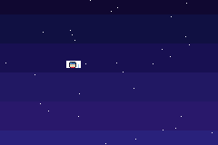

# Bouncers
 
Little yellow dots bounce around the screen on a Game Boy Advance. Made with Butano.
 

 
## Controls
 
- **A**: add a dot (up to 20)
- **B**: print the average x position in the console
## Run it
 
```
make
```
 
Then open `bouncers.gba` in mGBA.
